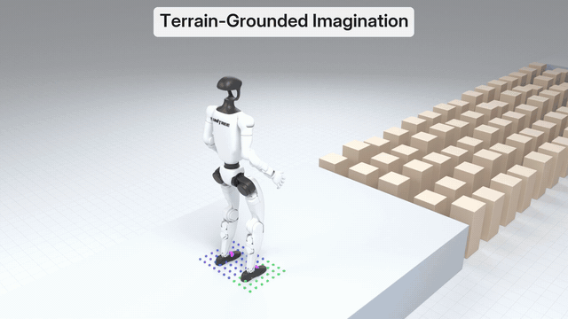
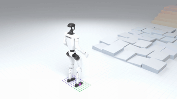
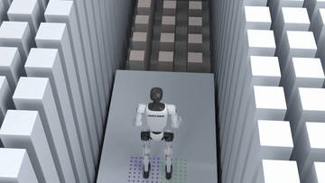
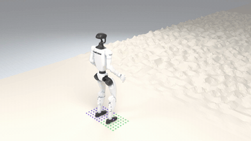
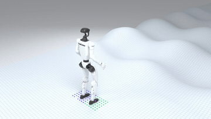
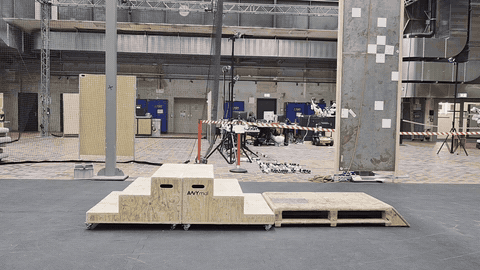

# Terrain-Grounded Imagination

<p align="center">
  
</p>

Code for *Terrain-Grounded Imagination: A Recipe for Humanoid Locomotion on Sparse Terrain through World Models* ([citation](#citation)).

Terrain-grounded imagination (TGI) trains a Unitree G1 humanoid to walk over stairs, gaps and stepping stones entirely through a learned world model. The world model learns only how the robot responds to the ground beneath it. The ground itself, the rewards and the robot's perception are read from the simulator's heightmap through cheap, differentiable lookups.

- **Terrain-conditioned world model.** The model predicts the robot's motion from the terrain it reads under the pelvis and the soles, instead of holding the terrain in its weights. The rewards, terminations and critic read the same heightmap, so gaps and edges are exact in imagination, and the gradient flows through the lookups.
- **Perception without rendering.** The policy uses the foothold-gated perception of [Watch Your Step](https://leggedrobotics.github.io/watch-your-step/): a foothold prediction model (FPM) predicts the next footholds from proprioception, and the policy sees the heightmap only around them. In imagination, the FPM runs on the imagined state and the patches are read at the imagined footholds, so the imagined observation is computed as in the simulator. The full height scan is an option.
- **Gradient cut at poorly supported touchdowns.** The policy backpropagates the return through 32 imagined steps, with a critic after them. The same lookups detect imagined touchdowns on which much of the sole is unsupported. The backpropagated gradient becomes unreliable there, so the return is cut and the critic takes over.

<table>
  <tr>
    <td width="50%"></td>
    <td width="50%"></td>
  </tr>
  <tr>
    <td align="center">Course</td>
    <td align="center">Corridor</td>
  </tr>
  <tr>
    <td width="50%"></td>
    <td width="50%"></td>
  </tr>
  <tr>
    <td align="center">Rough terrain</td>
    <td align="center">Steep waves</td>
  </tr>
</table>

<p align="center">
  <br>
  Testing on hardware
</p>

## Results

The released recipe (the defaults of `scripts/train.py`, 8192 environments) after 40k iterations, on the `fpm` validation suites (Isaac Lab 3, PhysX; see [Evaluation](#evaluation)). Mean ± standard deviation over five seeds, in %:

| Test | Metric | Result |
|---|---|---|
| Locomotion, 13 terrains | success / falls | 81.8 ± 2.5 / 1.7 ± 0.5 |
| Locomotion with 20 cm stepping stones | success / falls | 77.9 ± 2.1 / 5.5 ± 0.5 |
| Corridor, 39 sections | crossed / reached / fell | 92.3 ± 3.1 / 75.5 ± 7.3 / 12.3 ± 3.2 |

Training to 40k takes 0.82 billion simulator transitions: 15.6 h on a Quadro RTX 6000 or 10.9 h on an RTX 3090.

## Installation

The repository has two packages:

- [`fpm/`](fpm): the foothold prediction model and the G1 locomotion environments of [foothold-prediction-model](https://github.com/leggedrobotics/foothold-prediction-model), as an Isaac Lab 3 task package with PPO training, play and the validation suites.
- [`tgi/`](tgi): the world-model training. It runs the `fpm` environment on Newton physics, and its exported policies use the `fpm` observation and checkpoint formats, so they play and are evaluated in the `fpm` environments.

Tested on Linux with Isaac Lab 3.0.0 (Isaac Sim 6.1, Newton 1.6.1, PyTorch 2.11). Install [Isaac Lab 3.0](https://isaac-sim.github.io/IsaacLab/) first, then run the commands below in its Python environment (or use `<IsaacLab>/isaaclab.sh -p` in place of `python`).

1. Clone the repo and install both packages (`fpm` first):

   ```bash
   git clone https://github.com/leggedrobotics/terrain-grounded-imagination
   cd terrain-grounded-imagination
   pip install -e fpm --no-deps
   pip install -e tgi
   ```

2. Convert the G1 model for Newton (once):

   ```bash
   cd tgi
   python scripts/convert_g1_usd.py
   ```

3. Check the installation with a short run through every training phase (about 10 minutes, 12 GB of GPU memory):

   ```bash
   python scripts/train.py --log_dir logs/check --num_envs 2048 --vram_gb 12 --iterations 400 \
       --wm_only_iters 100 --fpm_bootstrap 150 --async_after 200 --ckpt_every 400 --eval_every 0 --quick_every 0
   python scripts/export.py --ckpt logs/check/ckpt_000400.pt
   ```

The TGI commands below run from `tgi/`, the `fpm` commands from `fpm/`.

## Training

```bash
scripts/pipeline.sh <run_name>
```

trains the full recipe from scratch into `logs/<run_name>/`, then exports, evaluates and records videos of the final policy. The recipe runs 100k iterations on 8192 environments and needs about 22 GB of GPU memory; on an 11 GB GPU, add `--num_envs 4096 --vram_gb 10.5`. Checkpoints are saved every 1000 iterations, with background course checks every 2k (`quick_<it>.txt`) and 20k iterations (`check_<it>.txt`). To train without the pipeline:

```bash
python scripts/train.py --log_dir logs/<run_name>
```

The first 300 iterations train only the world model. Until iteration 1500 the footholds are fixed under the robot; after that, the FPM places them.

The [results](#results) are the 40k checkpoint, and they change little after it. To stop there, add `--iterations 40000`; the learning rates decay over `--lr_decay_iters` (100k) whatever `--iterations` is, so this trains exactly the reported runs. The reported runs trained in fp32: on GPUs with native bf16, where the default is mixed precision, add `--amp none` to match them.

Measured speeds of the recipe:

| GPU | Environments | Speed |
|---|---|---|
| Quadro RTX 6000 (24 GB, fp32) | 8192 | 0.71 to 0.75 it/s (0.61 before the simulator overlap starts at iteration 1600); 15.6 h to 40k |
| RTX 3090 (24 GB) | 8192 | about 1.1 it/s; 10.9 h to 40k |
| RTX 2080 Ti (11 GB, fp32) | 4096 | 0.92 it/s after iteration 1600 |

To recover from a crash, `RESUME=1 scripts/pipeline.sh <run_name> [the run's extra flags]` continues from `last.pt`. Pass the run's extra flags again (for example `--num_envs 4096 --vram_gb 10.5`): a resume does not read them from the checkpoint. It restores the networks, the normalizers and the optimizers of the world model, policy and critic, but not the FPM's optimizer, the replay buffer or the curriculum statistics, so the terrain level dips for a few thousand iterations after it.

## Export

```bash
python scripts/export.py --ckpt logs/<run_name>/ckpt_100000.pt
```

writes `logs/<run_name>/export_100000/` with `model_100000.pt` (rsl-rl 3.3.0 checkpoint layout, observation normalization baked into the actor) and `foot_model_100000.pt` (TorchScript FPM), the `fpm` formats, plus `exported/policy.onnx`, `exported/foot_model.onnx` and `exported/deploy.json`. Play it in the `fpm` environment with `python scripts/play.py --checkpoint <export dir>/model_100000.pt` from `fpm/`.

A `--scan full` checkpoint exports without a foot model. Its policy reads the environment's `height_scan`, so run the `fpm` environments with `FPM_POLICY_SCAN=full` set, which swaps the policy's `foothold_scan` for `height_scan` (for example `FPM_POLICY_SCAN=full bash scripts/isaac_eval.sh ...`). `sim2sim.py` and the NumPy/ONNX controller in `tgi/deploy/` support the foothold interface only.

## Evaluation

```bash
python scripts/sim2sim.py --export_dir logs/<run_name>/export_100000 --terrains stairs:0.20 fpmstones:0.6 pit:0.30 --repeats 2
bash scripts/isaac_eval.sh logs/<run_name>/export_100000/model_100000.pt 520 cuda:0
```

`sim2sim.py` runs the exported ONNX controller in plain MuJoCo with Unitree's official G1 model, its own 500 Hz PD loop, 20 ms latency and ray-cast perception: stairs (`stairs:rise`), random blocks (`blocks:max_height`), stepping stones over a pit (`stones:gap[:size]`, `fpmstones:difficulty` for the training stones), drops (`drop:h`), and stepping out of a 2 x 2 m pit (`pit:h`). A course counts as crossed if the robot is upright and past it. `isaac_eval.sh` runs the `fpm` locomotion validation (13 terrains at difficulty 0.5, PhysX) as a quick check: 1100 steps with the startup randomization on, so its numbers are not comparable with the [results](#results), which use the full protocol below. `scripts/check.sh <ckpt>` runs both. Our sim2sim runs used MuJoCo 3.16.0; other MuJoCo versions give individual episodes that differ, so compare runs under one version.

The validation suites behind the [results](#results) are in `fpm/scripts` (see [fpm/README.md](fpm/README.md)); run them from `fpm/` with `--save_results` and the startup randomization zeroed (`env.events.base_com.params.com_range.{x,y,z}=[0.0,0.0] env.events.default_joint_pos_offset.params.position_range=[0.0,0.0]`):

- **Locomotion** (13 terrains): `python scripts/validate_locomotion.py --checkpoint <model.pt> --num_envs 520 --num_steps 3300 env.sim.physics.gpu_found_lost_pairs_capacity=16777216 env.sim.physics.gpu_found_lost_aggregate_pairs_capacity=67108864`. Larger env counts overflow PhysX's pair buffers and produce fake falls.
- **Locomotion with 20 cm stepping stones**: the same, plus `env.scene.terrain.terrain_generator.sub_terrains.train_stepping_stones.stone_width_range=[0.2,0.2] env.scene.terrain.terrain_generator.sub_terrains.train_stepping_stones.stone_distance_range=[0.2,0.2]`.
- **Corridor** (13 sections in each of three corridors: straight, stones, blocks): `python scripts/validate_corridor.py --checkpoint <model.pt> --rounds 4`.

To check the policy gradient, run `python scripts/grad_check.py --ckpt logs/<run_name>/ckpt_020000.pt --out logs/<run_name>/grad_check` (about 25 min on an RTX 2080 Ti). It compares the backpropagated gradient of the imagined objective with central finite differences over all 29 dimensions of the first action, for the plain H-step return and for the cut return, by terrain and horizon.

## Options

Every option is a flag of `scripts/train.py`; the defaults are the recipe. The observations below come from our runs. Unless a row says otherwise, they are single seeds, and the smaller tests used 4096 environments on RTX 2080 Ti GPUs, so treat them as indications, not settled results.

**Method**

| Flag | What it changes | Observed |
|---|---|---|
| `--scan foothold` / `full` | Policy perception: foothold patches (default), or the whole 1.6 x 1.0 m torso height scan (33 x 21 nodes, the base env's `height_scan`) with no FPM | one seed: behind the foothold patches at every checkpoint up to 50k; at 40k, locomotion success 75.0 vs 81.8 %, 20 cm stones 16.1 vs 29.0 %, corridor crossed 83.3 vs 92.3 % (foothold patches: five-seed mean) |
| `--fpm 0` | Fixed footholds under the base for the whole run (no learned FPM) | |
| `--wm_tau full` / `pelvis` / `none` | Terrain input of the world model: all features, only the pelvis height above the terrain, or none (rewards, terminations and contacts still read the terrain) | |
| `--pg_event 0.3`, `--pg_lambda 0` | Cut the gradient through the model at imagined touchdowns with an unsupported sole share above `pg_event`, and bootstrap from the critic there (`--pg_event 0`: plain H-step return) | part of the recipe |
| `--horizon 32` | Imagination horizon (steps of 20 ms) | 64: policy gradient norms about 10x higher, 27 % slower, no gain |
| `--lr_coef 0.1` | Weight of the likelihood-ratio (advantage) term next to backpropagation through the model | 0.5 together with `--w_foothold -6` was worse on the corridor and stepping stones |
| `--wm_opt muon` / `adam` | Optimizer of the world model's hidden weight matrices (Muon, RMS-matched to the Adam learning rate; Adam for biases, norms and small layers) | in an earlier short test (two seeds), Muon halved the world model's 8-step error and the policy learned faster early; about 10 % slower per iteration |
| `--pi_opt adam` / `muon` | The same for the policy | Muon on the policy learned clearly slower |
| `--sym_coef 2` | Left/right mirror-consistency loss on the policy | part of the recipe |

**Curriculum and environment**

| Flag | What it changes | Observed |
|---|---|---|
| `--sgs_target 0.8` | Success rate the terrain sampler aims for | 0.5 was not better (corridor stepping stones worse at 26k iterations) |
| `--straight_frac 0` | Share of episodes with no yaw command and no heading control, as in the evaluations | 0.05 made no measurable difference |
| `--stepping_stones 0.6`, `--pit_step 0.05` | Terrain mix | defaults |
| `--w_*`, `--term_hole`, `--term_angle` | Reward weights and imagined terminations | defaults |

**Heightmap resolution.** `--hm_res 0.04` is the tested resolution. At `--hm_res 0.01` the policy gradients explode (norms of 1e5 to 1e14 once the policy trains; clipping hides it, but learning stalls). `--grad_blur <sigma>` keeps the exact heights in the forward pass and takes the gradient from a Gaussian-blurred map; it does not fix 1 cm training, from scratch or warm-started (also with `--resume_wm_only`). `--hm_exact 1` computes the sole support from nearest-node heights; bilinear heights smear stone edges over a cell, so a centered foot on a 20 cm stone would read as unsupported.

**Speed** (none of these change the objective)

| Flag | What it does | Observed |
|---|---|---|
| `--compile 1`, `--cudagraphs 1` | `torch.compile`, CUDA graphs for the world-model update | default |
| `--cg_imag 1` | CUDA graph for the imagination step | together with fewer host syncs: +6 % (RTX 5080) to +24 % (RTX 2080 Ti) in the policy phase |
| `--async_collect 1` | Simulator collection in a thread, overlapping the updates; the simulator acts with a copy of the policy and FPM that is one iteration old. Starts at `--async_after` (1600: after the FPM bootstrap, so the CUDA graphs are recorded without the thread) | on top of `--cg_imag`: +12 % (RTX 2080 Ti) to +32 % (RTX 5080); the world model's error over training matches a run without it |
| `--amp bf16` | Mixed precision; on GPUs without native bf16 (compute capability below 8.0, e.g. RTX 2080 Ti, Quadro RTX 6000) training switches to fp32 by itself, since compiled bf16 graphs would fall back to eager | on a Quadro RTX 6000 (8192 environments, policy phase), the current code in fp32 ran at 0.61 it/s against 0.44 for the previous code in eager bf16 (this includes the other speedups) |
| `--vram_gb 22` | GPU memory budget of the whole run (simulator + torch); leaves the rest of the card free | 8192 environments need about 20 GB, 4096 fit in 10.5 GB |
| `TGI_PROF=1` | Environment variable: per-phase timing (ms per iteration) in the log | |

**Resuming.** `--resume <ckpt>` continues a run; `--resume_wm_only N` trains only the world model and FPM for the first N iterations after it (for example after changing the terrain features). `--max_hours` counts the current job's time only.

**PPO baseline.** `--algo ppo` trains the same policy with PPO on real rollouts, in the same environment, curriculum, perception, FPM co-training, critic features and reward (`--ppo_*`: rsl-rl settings of the base env). Our runs used `--algo ppo --async_collect 0 --fpm_bootstrap 150 --fpm_label_every 5 --fpm_steps 32 --ckpt_every 50 --log_every 10`; one PPO iteration (8192 environments x 24 steps) uses about 9.6x the simulator transitions of a TGI iteration. Checkpoints export and evaluate like TGI ones.

## Repository structure

```
fpm/                    Isaac Lab 3 task package (see fpm/README.md)
  src/fpm/
    tasks/locomotion/   G1 locomotion tasks: mdp terms, env and PPO configs (config/g1)
    terrains/           training, validation and corridor terrains
    foot_pred/          FPM network, foothold labels, supervised training
    assets/             G1 USD and articulation config
  scripts/              PPO train and play, validation suites
tgi/
  src/tgi/
    world_model/        world model, policy and critic networks, replay buffer
    foot_pred/          the FPM with a running normalizer, labels from the replay buffer, continual trainer
    mdp/                differentiable state, rewards, kinematics, heightmap lookups, the fpm observation interface
    env/                the fpm environment on Newton, domain randomization, success-guided curriculum, terrains
    training/           options, trainer, PPO baseline, simulator collection, optimizers, logging
    deploy/             NumPy/ONNX controller (policy + FPM + foothold scan) and the G1 PD gains
    assets/             G1 kinematics MJCF, Unitree's G1 MJCF for sim2sim
    policy_io.py        closed-loop execution in the simulator, checkpoint loading
  scripts/
    train.py            training entry point (options: python scripts/train.py --help)
    pipeline.sh         train from scratch, then final export, evaluation and videos
    grad_check.py       backpropagated vs. finite-difference gradients of the imagined objective
    export.py, sim2sim.py, stand_check.py, check.sh, isaac_eval.sh, convert_g1_usd.py
```

## Previous Work

TGI builds on:

- [SuperMimic](https://arxiv.org/abs/2610.28480): the training scheme, in which a world model is fit to simulator transitions and the policy is trained by backpropagating the return through short imagined rollouts.
- [Watch Your Step](https://arxiv.org/abs/2610.29612): the foothold-gated perception, the G1 locomotion environments and the validation suites.
- [SHAC](https://arxiv.org/abs/2204.07137): the policy objective, a short-horizon return backpropagated through time and bootstrapped with a critic.
- [Robotic World Model](https://arxiv.org/abs/2501.10100): fitting the world model on autoregressive rollouts, so that it learns from its own compounding errors.

## Citation

If you use this code, please cite:

```bibtex
@misc{heyrman2026tgi,
  author = {Heyrman, Matthias and Hutter, Marco},
  title  = {Terrain-Grounded Imagination: A Recipe for Humanoid Locomotion on Sparse Terrain through World Models},
  year   = {2026},
  note   = {Code: \url{https://github.com/leggedrobotics/terrain-grounded-imagination}},
  url    = {https://github.com/leggedrobotics/terrain-grounded-imagination}
}
```

If you use the foothold prediction model or the G1 environments in `fpm/`, please also cite:

```bibtex
@misc{heyrman2026watch,
  author        = {Heyrman, Matthias and Li, Chenhao and Dadiotis, Ioannis and Hutter, Marco},
  title         = {Watch Your Step: Anticipated Perception for Humanoid Locomotion},
  year          = {2026},
  eprint        = {2610.29612},
  archivePrefix = {arXiv}
}
```

## License

© 2026 ETH Zurich<br>
Created by: Matthias Heyrman and Marco Hutter<br>
Licensed under the MIT License (see [LICENSE](LICENSE)).

Third-party files keep their original license (see [licenses/dependencies](licenses/dependencies)):

- `fpm/src/fpm/assets/data/G1/` is the Unitree G1 (29 DoF, rev 1.0) model from [unitree_ros](https://github.com/unitreerobotics/unitree_ros), converted to USD, BSD-3-Clause.
- `tgi/src/tgi/assets/g1_kinematics.xml` is the Unitree G1 model from [mjlab](https://github.com/mujocolab/mjlab) with the meshes removed, Apache-2.0.
- `tgi/src/tgi/assets/unitree_g1/` is the Unitree G1 (29 DoF) MuJoCo model from [unitree_mujoco](https://github.com/unitreerobotics/unitree_mujoco), BSD-3-Clause.
